# Hey, I’m Akhil. Plant something before you leave.

I build scientific software, work with maps and models, and follow the occasional infrastructure rabbit hole.

[Website ↗](https://marupilla.dev) · [LinkedIn ↗](https://www.linkedin.com/in/gmarupilla) · [JOSS reviews ↗](https://joss.theoj.org/papers/reviewed_by/@gmarupilla)

### Leave a little life here

Choose an empty plot below. Pick a seed in the form, then submit the issue. The garden updates after your request runs.

| | 1 | 2 | 3 | 4 | 5 | 6 |
|---|---|---|---|---|---|---|
| **A** | [＋ A1](https://github.com/gmarupilla/gmarupilla/issues/new?template=plant.yml&plot=A1) | [＋ A2](https://github.com/gmarupilla/gmarupilla/issues/new?template=plant.yml&plot=A2) | [＋ A3](https://github.com/gmarupilla/gmarupilla/issues/new?template=plant.yml&plot=A3) | [＋ A4](https://github.com/gmarupilla/gmarupilla/issues/new?template=plant.yml&plot=A4) | [＋ A5](https://github.com/gmarupilla/gmarupilla/issues/new?template=plant.yml&plot=A5) | [＋ A6](https://github.com/gmarupilla/gmarupilla/issues/new?template=plant.yml&plot=A6) |
| **B** | [＋ B1](https://github.com/gmarupilla/gmarupilla/issues/new?template=plant.yml&plot=B1) | [＋ B2](https://github.com/gmarupilla/gmarupilla/issues/new?template=plant.yml&plot=B2) | [＋ B3](https://github.com/gmarupilla/gmarupilla/issues/new?template=plant.yml&plot=B3) | [＋ B4](https://github.com/gmarupilla/gmarupilla/issues/new?template=plant.yml&plot=B4) | [＋ B5](https://github.com/gmarupilla/gmarupilla/issues/new?template=plant.yml&plot=B5) | [＋ B6](https://github.com/gmarupilla/gmarupilla/issues/new?template=plant.yml&plot=B6) |
| **C** | [＋ C1](https://github.com/gmarupilla/gmarupilla/issues/new?template=plant.yml&plot=C1) | [＋ C2](https://github.com/gmarupilla/gmarupilla/issues/new?template=plant.yml&plot=C2) | [＋ C3](https://github.com/gmarupilla/gmarupilla/issues/new?template=plant.yml&plot=C3) | [＋ C4](https://github.com/gmarupilla/gmarupilla/issues/new?template=plant.yml&plot=C4) | [＋ C5](https://github.com/gmarupilla/gmarupilla/issues/new?template=plant.yml&plot=C5) | [＋ C6](https://github.com/gmarupilla/gmarupilla/issues/new?template=plant.yml&plot=C6) |
| **D** | [＋ D1](https://github.com/gmarupilla/gmarupilla/issues/new?template=plant.yml&plot=D1) | [＋ D2](https://github.com/gmarupilla/gmarupilla/issues/new?template=plant.yml&plot=D2) | [＋ D3](https://github.com/gmarupilla/gmarupilla/issues/new?template=plant.yml&plot=D3) | [＋ D4](https://github.com/gmarupilla/gmarupilla/issues/new?template=plant.yml&plot=D4) | [＋ D5](https://github.com/gmarupilla/gmarupilla/issues/new?template=plant.yml&plot=D5) | [＋ D6](https://github.com/gmarupilla/gmarupilla/issues/new?template=plant.yml&plot=D6) |

**Seed shelf:** Oak · Pine · Sunflower · Tulip · Mushroom · Wheat

One plant per person per UTC day. Sprouts grow after one day and mature after four. After 21 days, they return to soil.

The garden refreshes daily and after planting requests. Weather is part of this imaginary world.

Meet the gardeners & recent planting requests

The first plot is waiting for its caretaker.

**Recent requests**

### A few other things I’m growing

Also on the workbench: [TrialFlow-Agro](https://github.com/gmarupilla/trialflow-agro), a reproducible workflow for agricultural field trials.

Inspired by [Tim Burgan’s community chess](https://github.com/timburgan/timburgan). This garden uses original code and artwork.
